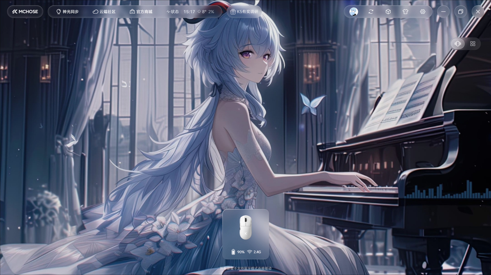
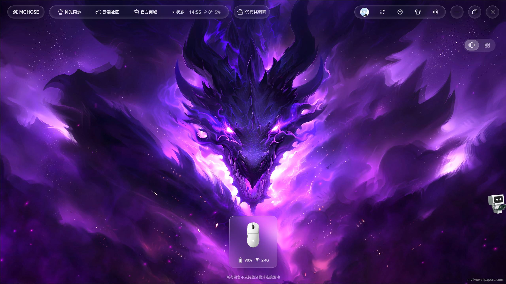
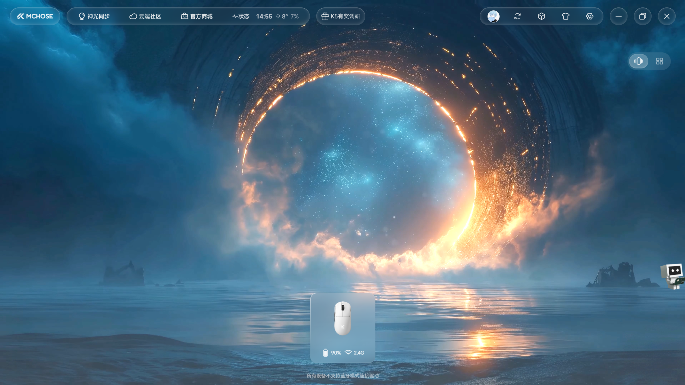

<div align="center">

# M HUB Wallpaper & Startup Plugin

### 壁纸与启动页，焕然新生 // Wallpaper Reimagined

[](https://github.com/GuXiaoYan666/mhub-wallpaper-plugin/releases/latest)
[](LICENSE)
[](#环境要求)
[](#从源码构建)

### [⬇ 下载安装](#安装) · [📖 使用指南](#安装) · [⚙ 技术说明](#实现原理) · [❓ 常见问题](#常见问题)

**最新安装包：[M-HUB-Wallpaper-Startup-Plugin.exe](https://github.com/GuXiaoYan666/mhub-wallpaper-plugin/releases/latest)**

</div>

---

## 目录

- [核心特性](#核心特性)
- [效果展示](#效果展示)
- [环境要求](#环境要求)
- [安装](#安装)
- [卸载](#卸载)
- [实现原理](#实现原理)
- [从源码构建](#从源码构建)
- [目录结构](#目录结构)
- [常见问题](#常见问题)
- [免责声明](#免责声明)
- [许可证](#许可证)

---

## 核心特性

- 把 **Wallpaper Engine 本地壁纸**用作 M HUB 自身界面背景，不修改 Windows 桌面壁纸
- 主题设置内新增「壁纸 / 启动页」控制中心
- 自定义启动动画，支持完整视频播放、音效、跳过与进度显示
- 可配置启动页背景、玻璃效果、窗口控制与启动最大化
- 场景壁纸支持自定义裁剪位置，附带独立实时预览窗口
- 壁纸切换快捷键（上一张 / 下一张 / 随机 / 暂停恢复 / 打开预览），支持自定义录制
- 一键安装、卸载还原；**不修改官方 `app.asar` 内容**
- 可选附带歌词补丁与系统监控仪表板

| 模块 | 说明 |
| :--- | :--- |
| 壁纸背景 | 读取 Wallpaper Engine 项目，注入 M HUB 渲染页作为界面背景 |
| 主题设置面板 | 在「设置 → 主题设置」内嵌壁纸与启动页控制中心 |
| 启动动画 | 可替换为自定义动画并完整播放；关闭后完全沿用官方启动页 |
| 裁剪 | 场景壁纸可拖动调整裁剪位置，独立窗口实时预览 |
| 快捷键 | 五类操作可自定义，支持冲突检测与恢复默认 |
| 歌词补丁 | 在 M HUB 内显示歌词（可随安装器一并部署） |
| 仪表板 | 系统监控与桌面悬浮窗（可随安装器一并部署） |
| 卸载还原 | 恢复官方 `app.asar` 与官方启动页，清理插件文件 |

> 非官方项目，与迈从科技无关联。使用前请阅读文末[免责声明](#免责声明)。

---

## 效果展示

### 演示视频

<div align="center">

<video src="assets/demo/demo.mp4" controls width="90%" poster="assets/screenshots/purple-dragon.png">
  你的浏览器不支持视频播放，可直接下载：<a href="assets/demo/demo.mp4">demo.mp4</a>
</video>

</div>

### 界面截图

以下均为插件注入后的真实 M HUB 界面，底部设备卡片与顶部控件可正常交互。

|  |  |
| :---: | :---: |
|  |  |
| 二次元角色 · 钢琴场景 | 紫焰巨龙 · 暗黑奇幻 |
|  |  |
| 银白少女 · 哥特风 | 海面星门 · 科幻场景 |

壁纸层默认开启 `pointer-events: none`，不会遮挡 M HUB 原有按钮、设备卡片与悬停效果。

---

## 环境要求

- Windows 10 / 11（x64）
- 已安装 M HUB（默认安装路径：`C:\Program Files\M HUB`）
- 可选：Wallpaper Engine（使用壁纸功能时需要）
- 构建需要 .NET Framework 4.x 的 `csc.exe`（Windows 自带）

---

## 安装

1. 前往 [**Releases 下载页**](https://github.com/GuXiaoYan666/mhub-wallpaper-plugin/releases/latest)，下载最新的 `M-HUB-Wallpaper-Startup-Plugin.exe`。
2. 完全关闭 M HUB。
3. 运行安装器，按提示完成安装。
4. 启动 M HUB，进入「设置 → 主题设置」即可看到壁纸与启动页控制中心。

安装完成后会在以下位置留下日志，便于排查问题：

| 日志路径 | 记录内容 |
| :--- | :--- |
| `%APPDATA%\MCHOSEHUB\wallpaper-hub\bootstrap.log` | 入口加载、插件加载、启动页拦截 |
| `%APPDATA%\MCHOSEHUB\wallpaper-hub\wallpaper-hub.log` | 壁纸扫描与注入日志 |

---

## 卸载

再次运行安装器并选择卸载，或使用命令行：

```powershell
M-HUB-Wallpaper-Startup-Plugin.exe /uninstall "C:\Program Files\M HUB"
```

卸载流程会：

- 恢复官方 `app.asar`
- 恢复官方启动页与 `openanimation.mp4`
- 删除插件注入文件与插件目录

> 如果安装后 M HUB 官方升级过（`app.asar` 被重新生成），安装器会停止还原并提示先重新安装插件再卸载，避免覆盖新版官方文件。

---

## 实现原理

- **不改官方归档内容**：`resources\app.asar` 仅改名保留为 `app.mhub-wallpaper-original.asar`。
- **独立入口**：`resources\app\out\main\index.js` 先加载插件，再加载官方归档，因此启动页窗口创建前保护已生效。
- **启动页保护**：包装 `BrowserWindow` 的 `close / destroy / hide`，拦截官方提前关闭启动页；拦截最长 90 秒，挂载失败立即放行。
- **渲染注入**：主进程通过 `web-contents-created` / `dom-ready` / `did-finish-load` 注入 `shell.js`，上行使用 `console.dir('[mhub-wp]' + JSON)`，下行使用 `window.__mhubWpReceive(JSON)`。
- **路由持久化**：常驻 CSS + `hashchange/popstate` 监听，切换页面后背景层不会退回官方壁纸。

---

## 从源码构建

```powershell
# 在仓库根目录执行
powershell -ExecutionPolicy Bypass -File .\build\build.ps1
```

- 产物路径：`dist\M-HUB-Wallpaper-Startup-Plugin-<版本>.exe`
- 脚本会打印文件大小与 SHA256 校验值
- 版本号取自最近的 git tag
- 安装器使用 .NET Framework 的 `csc.exe` 编译，`payload` 以嵌入资源方式打包，无需额外依赖

---

## 目录结构

```
build/build.ps1                  构建脚本（打包 payload + 编译安装器）
src/installer/Installer.cs       安装 / 卸载 / 校验 / 备份还原
src/installer/app.manifest       管理员权限清单
src/payload/bootstrap/           独立加载入口（package.json + out/main/index.js）
src/payload/pethub/              启动页关闭保护 + 壁纸加载 shim
src/payload/wallpaper-hub/       壁纸主进程插件（扫描、协议、快捷键、注入）
src/payload/renderer/            启动动画页面、样式、脚本与音效
src/plugins/lyric-bridge/        歌词补丁
src/plugins/sysdeck/             仪表板
assets/screenshots/              README 效果展示截图
assets/demo/demo.mp4             功能演示视频
```

---

## 常见问题

### 启动动画只播几秒就没了

旧版本没有在官方创建窗口前挂载保护。请安装最新版本；仍异常时查看 `bootstrap.log` 是否有 `splash-hold` 记录。

### 主题设置里没有控制中心

说明主进程没有加载插件。查看 `bootstrap.log` 是否有 `plugin-ok`，若无则入口未生效，重新运行安装器即可。

### 切换页面后壁纸变回官方壁纸

已在 v3.4.0 修复：官方壁纸容器改为常驻 CSS 隐藏，并在路由切换时立即重新对齐背景层。

### 底部设备卡片点不了 / 没有悬停

v3.4.0 已强制壁纸层 `pointer-events:none`，并把背景层压到最底层；若仍异常，关闭壁纸开关对比，并提交 `bootstrap.log` 排查。

---

## 免责声明

本项目为非官方第三方插件，与迈从科技（MCHOSE）无任何关联，未获得官方授权或认可。安装会改变 M HUB 的应用入口文件，可能导致官方更新失败或出现兼容问题。请自行评估风险，建议在安装前备份安装目录。

---

## 许可证

个人非商业使用 + 相同方式共享，详见 [LICENSE](LICENSE)。
