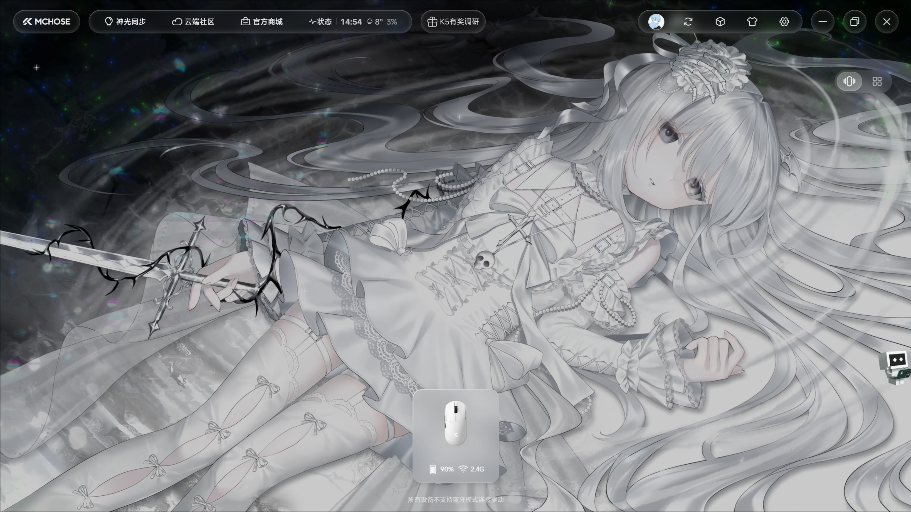

<div align="center">

# M HUB Wallpaper & Startup Plugin

### 壁纸与启动页，焕然新生 // Wallpaper Reimagined

[](https://github.com/GuXiaoYan666/mhub-wallpaper-plugin/releases/latest)
[](LICENSE)
[](#环境要求)
[](#从源码构建)

### [⬇ 下载安装](#安装) · [📖 使用指南](#安装) · [⚙ 技术说明](#实现原理) · [❓ 常见问题](#常见问题)

**最新安装包：[M-HUB-Wallpaper-Startup-Plugin.exe](https://github.com/GuXiaoYan666/mhub-wallpaper-plugin/releases/latest)**

</div>

---

## 目录

- [核心特性](#核心特性)
- [效果展示](#效果展示)
- [可选插件](#可选插件)
- [环境要求](#环境要求)
- [安装](#安装)
- [卸载](#卸载)
- [实现原理](#实现原理)
- [从源码构建](#从源码构建)
- [目录结构](#目录结构)
- [常见问题](#常见问题)
- [免责声明](#免责声明)
- [许可证](#许可证)

---

## 核心特性

- 把 **Wallpaper Engine 本地壁纸**用作 M HUB 自身界面背景，不修改 Windows 桌面壁纸
- 自动发现 Steam 多库与常见 WeGame 安装目录，也可添加任意自定义壁纸库
- 主题设置内新增「壁纸 / 启动页」控制中心，按来源筛选并显示版本与作者「顾小颜」
- 支持收藏、最近使用、全部或收藏范围随机轮换
- 使用离线 WebWallGL 渲染兼容的 `scene.pkg` / `scene.json` 场景，失败时回退静态预览
- 场景性能档位、帧率与渲染精度配置，页面隐藏时可暂停渲染
- 自定义启动动画，支持完整视频播放、音效、跳过与进度显示
- 可配置启动页背景、玻璃效果、窗口控制与启动最大化
- 壁纸支持自定义裁剪位置，附带独立实时预览窗口
- 壁纸切换快捷键（上一张 / 下一张 / 随机 / 暂停恢复 / 打开预览），支持自定义录制
- 壁纸作为背景铺底，**默认保留官方设备图标、名称与电量等前景层**；可在面板开启「覆盖官方前景层」只显示壁纸
- 一键安装、卸载还原；**不修改官方 `app.asar` 内容**
- 可选附带完整桌宠、歌词补丁与系统状态面板

| 模块 | 说明 |
| :--- | :--- |
| 壁纸背景 | 读取 Wallpaper Engine 项目，注入 M HUB 渲染页作为界面背景 |
| 壁纸库 | 合并 Steam、WeGame 与手动目录；移除自定义来源不会删除磁盘文件 |
| 场景渲染 | 离线 WebWallGL + 受限资源协议；提供省电、均衡、画质三档 |
| 收藏与轮换 | 收藏、最近 30 条记录、全部或收藏范围随机切换与定时轮换 |
| 主题设置面板 | 在「设置 → 主题设置」内嵌壁纸与启动页控制中心 |
| 启动动画 | 可替换为自定义动画并完整播放；关闭后完全沿用官方启动页 |
| 裁剪 | 壁纸可拖动调整裁剪位置，独立窗口实时预览 |
| 快捷键 | 五类操作可自定义，支持冲突检测与恢复默认 |
| 前景层 | 壁纸位于最底层，设备图标、名称与状态保持可见；可用「覆盖官方前景层」开关切换为纯壁纸 |
| 歌词补丁 LyricBridge | 多平台歌词/字幕推送到 K20 GT 字幕音响屏幕（可随安装器一并部署） |
| 桌宠 pet-hub | 完整桌宠 1.0.12：动作、互动、成长、改名与导入图集（可随安装器一并部署） |
| 状态面板 SenseDeck | 系统监控、天气、农历与桌面悬浮窗（可随安装器一并部署） |
| 卸载还原 | 恢复官方 `app.asar` 与官方启动页，清理插件文件 |

> 非官方项目，与迈从科技无关联。使用前请阅读文末[免责声明](#免责声明)。

---

## 效果展示

### 演示视频

<div align="center">

<video src="https://github.com/GuXiaoYan666/mhub-wallpaper-plugin/raw/master/assets/demo/demo.mp4" controls muted width="90%" poster="https://github.com/GuXiaoYan666/mhub-wallpaper-plugin/raw/master/assets/screenshots/purple-dragon.png">
  你的浏览器不支持视频播放，可直接下载：<a href="https://github.com/GuXiaoYan666/mhub-wallpaper-plugin/raw/master/assets/demo/demo.mp4">demo.mp4</a>
</video>

[▶ 视频无法播放时点此打开](https://github.com/GuXiaoYan666/mhub-wallpaper-plugin/raw/master/assets/demo/demo.mp4)

</div>

### 界面截图

以下均为插件注入后的真实 M HUB 界面，底部设备卡片与顶部控件可正常交互。

|  |  |
| :---: | :---: |
|  |  |
| 二次元角色 · 钢琴场景 | 紫焰巨龙 · 暗黑奇幻 |
|  |  |
| 银白少女 · 哥特风 | 海面星门 · 科幻场景 |

壁纸层默认开启 `pointer-events: none`，位于官方前景层之下，不会遮挡 M HUB 原有按钮、设备卡片、悬停效果与设备图标名称。

---

## 可选插件

两个插件均为独立模块，使用各自的目录、备份、日志与页面全局变量，互不影响，可同时安装，也可随主安装器一并部署。

### LyricBridge 歌词桥（v1.3.10）

把歌词与视频字幕实时推送到 **K20 GT 字幕音响**的屏幕上，同时在 M HUB 顶部显示歌词工具条与播放器面板。

- **多播放器支持**：识别 Apple Music、QQ 音乐、网易云、酷狗、酷我、汽水、咪咕、洛雪、千千、Folia、Mineradio 及 B 站桌面客户端；通过运行进程自动发现，无需手动配置
- **Apple Music**：支持 Windows 版进程与 Store 包/AUMID 识别，通过 Windows 系统媒体会话读取播放信息
- **在线歌词**：读取 Windows 系统媒体会话（SMTC/GSMTC），LRCLIB 与网易云双源回退，中文歌覆盖更好；自动缓存，断网可用
- **精准匹配**：歌手一致性校验，修复同名不同人错配；自动剥离 `(Live)` 等后缀、过滤署名行；繁体歌词自动转简体
- **B 站字幕**：自动抓取官方/AI 字幕并按时间轴逐句显示，支持多分 P、扫码登录、网页端浏览器适配
- **双行翻译**：带翻译的歌词以原文 + 译文两行展示，当前行高亮并附上下文
- **简约播放器**：M HUB 内嵌迷你播放卡片，显示真实封面、进度，支持上下首、暂停与进度拖动

配置目录：`%APPDATA%\MCHOSEHUB\lyric-bridge\`；日志：`%APPDATA%\MCHOSEHUB\lyric-bridge.log`。

### SenseDeck 状态仪表盘（v1.6.0）

在 M HUB 顶部导航注入「状态」芯片，点击展开一块可拖拽的液态玻璃仪表盘，并支持弹出为独立桌面悬浮窗。

- **系统监控**：CPU / 内存 / 网速实时曲线、磁盘占用（超 85% 变红）、电池状态、开机时长与主机名
- **时钟与农历**：大字时钟、农历月日、干支生肖、24 节气与传统节日徽章，纯本地计算（1900–2100）
- **天气**：主温度、体感、湿度、风力与三日预报，wttr.in / Open-Meteo 双源回退，支持手动指定城市
- **效率工具**：已移除番茄钟与倒数日，专注降低常驻内存占用
- **桌面悬浮窗**：无边框透明置顶、不占任务栏、位置记忆，与 M HUB 内面板数据实时同步
- **Wallpaper Engine 卡片**：显示壁纸运行状态与最近使用列表，支持一键暂停/播放/切换，静态图片可直接设为桌面壁纸；仅调用 WPE 官方命令行，不注入 WPE 文件
- **主题**：跟随 M HUB 明暗模式自动切换，面板质感与 M HUB 原生卡片一致

配置目录：`%APPDATA%\MCHOSEHUB\sysdeck\`；日志：`%APPDATA%\MCHOSEHUB\sysdeck.log`。

### pet-hub 完整桌宠（v1.0.12）

完整保留第三方桌宠 1.0.12 原始包，作为可选组件随安装器部署，可与壁纸、歌词和状态面板同时运行。

- **桌面表现**：透明置顶窗口、9 组动作、0–150% 连续缩放、拖拽与边缘漫游
- **成长与互动**：成长值、改名、情绪气泡、设备事件播报与全屏静默
- **图集管理**：支持导入自定义图集，高清缓存上限 3 条 / 96MB
- **数据保护**：安装、升级与卸载均保留 `%APPDATA%\MCHOSEHUB\pet-hub.json`、成长/改名数据、日志、`hd-cache` 与用户导入图集

配置目录：`%APPDATA%\MCHOSEHUB\`；桌面资源：`<安装目录>\resources\app\pet-hub\pets`。

### 共存与维护

- 两者目录独立（`resources\app\lyric-bridge` 与 `resources\app\sysdeck`），可同时安装
- 建议安装顺序：先 LyricBridge，再 SenseDeck；卸载顺序相反
- 官方 M HUB 升级后需重新运行安装器

---

## 环境要求

- Windows 10 / 11（x64）
- 已安装 M HUB（默认安装路径：`C:\Program Files\M HUB`）
- 可选：Steam 或 WeGame 版 Wallpaper Engine，或包含 `project.json` 的自定义壁纸目录
- 场景动态渲染需要 M HUB 内置 Chromium 支持 WebGL2；不支持的场景会保留静态预览
- Apple Music 曲目、封面与播放状态取决于 Windows 媒体会话实际提供的数据；歌词仍依赖在线源匹配或缓存
- 构建需要 .NET Framework 4.x 的 `csc.exe`（Windows 自带）

---

## 安装

1. 前往 [**Releases 下载页**](https://github.com/GuXiaoYan666/mhub-wallpaper-plugin/releases/latest)，下载最新的 `M-HUB-Wallpaper-Startup-Plugin-<版本>.exe`。
2. 完全关闭 M HUB。
3. 运行安装器，按提示完成安装。
4. 启动 M HUB，进入「设置 → 主题设置」即可看到壁纸与启动页控制中心。

安装完成后会在以下位置留下日志，便于排查问题：

| 日志路径 | 记录内容 |
| :--- | :--- |
| `%APPDATA%\MCHOSEHUB\wallpaper-hub\bootstrap.log` | 入口加载、插件加载、启动页拦截 |
| `%APPDATA%\MCHOSEHUB\wallpaper-hub\wallpaper-hub.log` | 壁纸扫描与注入日志 |

---

## 卸载

再次运行安装器并选择卸载，或使用命令行：

```powershell
M-HUB-Wallpaper-Startup-Plugin.exe /uninstall "C:\Program Files\M HUB"
```

卸载流程会：

- 恢复官方 `app.asar`
- 恢复官方启动页与 `openanimation.mp4`
- 删除插件注入文件与插件目录

卸载不会删除 `%APPDATA%\MCHOSEHUB\wallpaper-hub` 中的配置、收藏和最近记录，也不会删除 Steam、WeGame 或自定义目录中的壁纸。

> 如果安装后 M HUB 官方升级过（`app.asar` 被重新生成），安装器会停止还原并提示先重新安装插件再卸载，避免覆盖新版官方文件。

---

## 实现原理

- **不改官方归档内容**：`resources\app.asar` 仅改名保留为 `app.mhub-wallpaper-original.asar`。
- **独立入口**：`resources\app\out\main\index.js` 先加载插件，再加载官方归档，因此启动页窗口创建前保护已生效。
- **启动页保护**：包装 `BrowserWindow` 的 `close / destroy / hide`，拦截官方提前关闭启动页；拦截最长 90 秒，挂载失败立即放行。
- **渲染注入**：主进程通过 `web-contents-created` / `dom-ready` / `did-finish-load` 注入 `shell.js`，上行使用 `console.dir('[mhub-wp]' + JSON)`，下行使用 `window.__mhubWpReceive(JSON)`。
- **场景渲染**：随包加载本地 WebWallGL UMD，经 `mhub-wp` 自定义协议读取当前项目内资源；协议阻止越界路径，渲染失败自动销毁实例并回退静态预览。
- **路由持久化**：常驻 CSS + `hashchange/popstate` 监听，切换页面后背景层不会退回官方壁纸。

---

## 从源码构建

```powershell
# 在仓库根目录执行，并明确指定发布版本
powershell -ExecutionPolicy Bypass -File .\build\build.ps1 -ReleaseVersion 4.0
```

- 产物路径：`dist\M-HUB-Wallpaper-Startup-Plugin-<版本>.exe`
- 脚本会打印文件大小与 SHA256 校验值
- 未指定 `-ReleaseVersion` 或 `MHUB_VERSION` 时，版本号取自最近的 git tag
- 构建会校验离线 WebWallGL 文件及 UMD 固定 SHA256，无需联网下载依赖
- 安装器使用 .NET Framework 的 `csc.exe` 编译，`payload` 以嵌入资源方式打包，无需额外依赖

---

## 目录结构

```
build/build.ps1                  构建脚本（打包 payload + 编译安装器）
src/installer/Installer.cs       安装 / 卸载 / 校验 / 备份还原
src/installer/app.manifest       管理员权限清单
src/payload/bootstrap/           独立加载入口（package.json + out/main/index.js）
src/payload/wallpaper-hub/startup-guard.js  启动页关闭保护（独立于桌宠）
src/payload/wallpaper-hub/       壁纸主进程插件（扫描、协议、快捷键、注入）
src/payload/wallpaper-hub/renderer/scene.js  场景生命周期、性能档位与 WebWallGL 适配
src/payload/wallpaper-hub/vendor/webwallgl/  离线 WebWallGL 3.0.1 及 MIT 许可证
src/plugins/lyric-bridge/        LyricBridge 歌词桥（K20 GT 字幕音响）
src/plugins/sysdeck/             SenseDeck 状态面板
third_party/pet-hub-patch-1.0.12/  完整桌宠 1.0.12（固定版本，构建时校验 61 个文件哈希）
assets/screenshots/              README 效果展示截图
assets/demo/demo.mp4             功能演示视频
```

---

## 常见问题

### 启动动画只播几秒就没了

旧版本没有在官方创建窗口前挂载保护。请安装最新版本；仍异常时查看 `bootstrap.log` 是否有 `splash-hold` 记录。

### 主题设置里没有控制中心

说明主进程没有加载插件。查看 `bootstrap.log` 是否有 `plugin-ok`，若无则入口未生效，重新运行安装器即可。

### 切换页面后壁纸变回官方壁纸

已在 v3.4.0 修复：官方壁纸容器改为常驻 CSS 隐藏，并在路由切换时立即重新对齐背景层。

### 壁纸盖住了设备名称 / 图标

v4.0 起壁纸默认压到官方前景层之下，设备图标、名称与电量正常显示。若想只留壁纸，在「播放与场景性能」中开启「覆盖官方前景层」；关闭即恢复官方信息。仍异常时先切换该开关对比，并提交 `wallpaper-hub.log`。

---

## 免责声明

本项目为非官方第三方插件，与迈从科技（MCHOSE）无任何关联，未获得官方授权或认可。安装会改变 M HUB 的应用入口文件，可能导致官方更新失败或出现兼容问题。请自行评估风险，建议在安装前备份安装目录。

---

## 许可证

个人非商业使用 + 相同方式共享，详见 [LICENSE](LICENSE)。

第三方组件 WebWallGL 3.0.1（作者 oneincase）按 MIT 许可证分发，原始许可证随包保存在 `src/payload/wallpaper-hub/vendor/webwallgl/LICENSE`；主项目许可证不替代第三方组件许可证。
